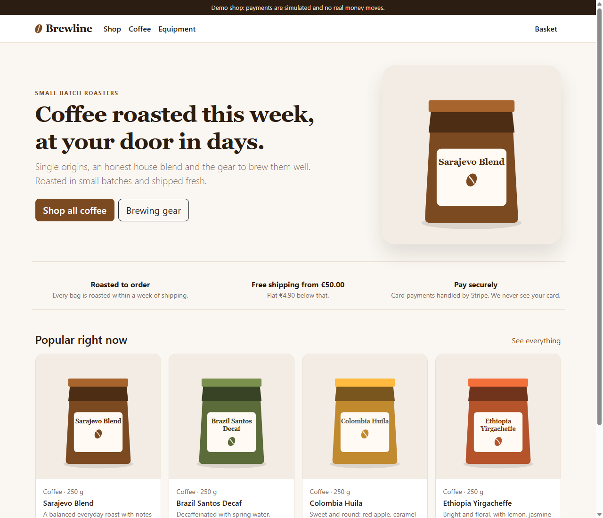
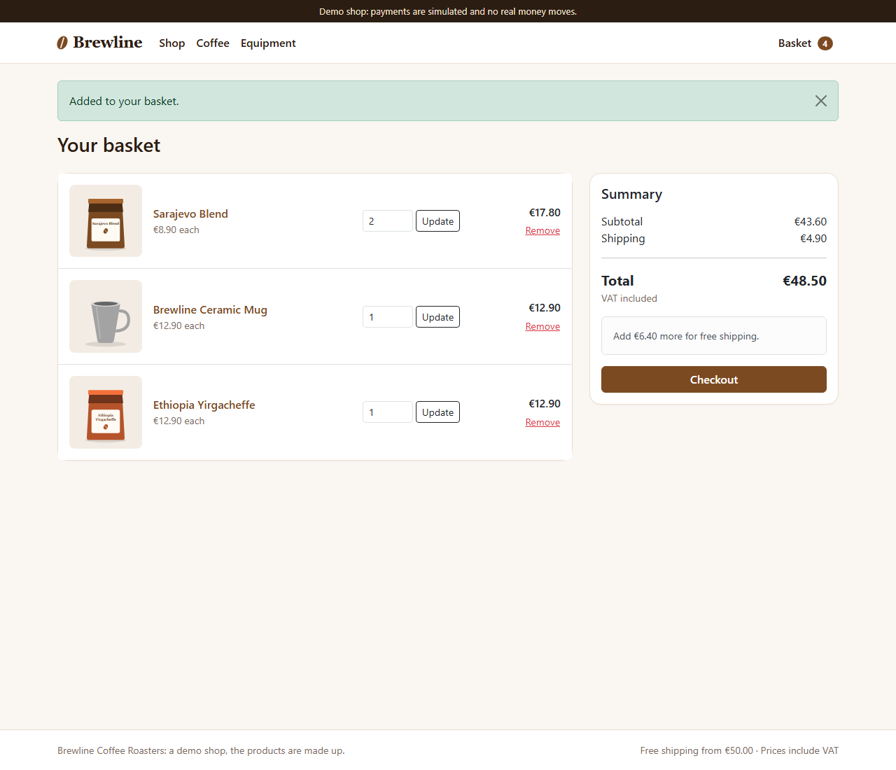
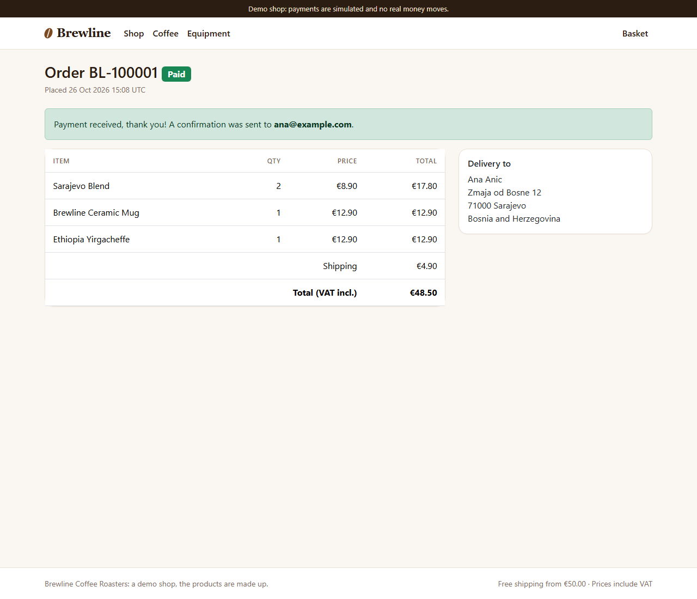

# Brewline

[](https://github.com/Emir0404/Brewline/actions/workflows/ci.yml)

A complete **online shop with card payments** (Stripe Checkout), built with ASP.NET Core 10 MVC and EF Core.
Browse a catalogue, fill a basket, check out as a guest, pay, get a confirmation email, and manage products and
orders in an admin area. The shop sells (made-up) coffee and brewing gear.



## Features

**Customers**
- Catalogue with categories, search, stock badges ("Only 3 left", "Sold out") and generated product pictures
- Basket that survives browser restarts (stored server-side, found through a random cookie)
- Guest checkout, free shipping from 50.00, flat 4.90 below that
- Pay with **Stripe Checkout** (hosted payment page, so card data never touches this server)
- Order page reachable only through an unguessable link; if payment is not finished the customer can pay again or cancel
- Confirmation and shipping emails

**Shop owner (admin area)**
- Orders with status filters, details, "mark as shipped" (emails the customer)
- Products: add, edit, hide, price and stock
- Login protected against brute force; switched off completely unless credentials are configured

| Basket | Order paid |
|---|---|
|  |  |

## Payments: how it works (and how to try it)

The part most shops get wrong is *knowing when someone really paid*. Here:

1. Checkout creates an order in state **Pending** and **reserves the stock**.
2. The customer is sent to Stripe's hosted page.
3. **Only a signed webhook from Stripe marks the order Paid**, never the customer's browser returning to a
   "thank you" page. The signature and its age are verified, and the paid amount and currency must match the order.
4. The order page waits for that webhook and refreshes itself, so the customer sees the result within seconds.

### Demo mode (default, no account needed)

`Payments:Provider` is `Demo`: instead of Stripe the customer lands on a simulated payment page. It calls
exactly the same code the webhook calls, so everything after payment (emails, stock, admin) behaves identically.
A banner makes the demo status obvious. No money moves.

### Stripe mode (test or live)

1. Create a free Stripe account and copy the **test** secret key (`sk_test_...`).
2. Forward webhooks to your machine with the [Stripe CLI](https://stripe.com/docs/stripe-cli):
   `stripe listen --forward-to http://localhost:5097/webhooks/stripe` (it prints a `whsec_...` signing secret).
3. Configure (user secrets, never commit keys):

```bash
cd src/Brewline.Web
dotnet user-secrets set "Payments:Provider" "Stripe"
dotnet user-secrets set "Payments:StripeSecretKey" "sk_test_..."
dotnet user-secrets set "Payments:StripeWebhookSecret" "whsec_..."
```

Pay with Stripe's test card `4242 4242 4242 4242` (any future date, any CVC). With the provider set to Stripe and
a key missing, the app refuses to start instead of failing on the first customer.

## The interesting engineering

- **No overselling.** Stock is taken with one conditional `UPDATE ... WHERE Stock >= quantity`, so two customers
  buying the last bag at the same moment cannot both succeed, and a `CHECK (Stock >= 0)` constraint in the
  database is the safety net. If one line of an order fails, the whole order rolls back.
- **Abandoned payments.** Unpaid orders are cancelled after 60 minutes by a background service (and by Stripe's
  "session expired" event), which puts the stock back on sale.
- **Late payment for a cancelled order.** If money arrives after we gave up on the order, the shop tries to take the
  stock again; if it is gone the order is flagged **NeedsReview** for a human (refund) instead of silently overselling.
- **Idempotent webhooks.** Stripe may deliver the same event several times; the order is paid and the email sent once.
- **Money in integer cents** end to end (matches Stripe, no floating-point surprises). Prices and names are copied
  onto the order, so a later price change never rewrites history.
- **Server-side prices only.** Nothing price-related is read from the browser; a test posts fake prices to prove it.
- **Guest order privacy.** Order links use 128-bit random tokens; `/orders/BL-100001` is a 404.
- **Security basics:** anti-forgery token on every POST (global filter), CSP and security headers (the CSP allows
  the redirect to Stripe), HTML encoding everywhere, constant-time admin credential check, login rate limit,
  redirects only to local addresses, no secrets in the repository.

## Architecture

```
Controllers ──► CatalogService / CartService / CheckoutService / OrderService
                                   │                    │
                                   ▼                    ▼
                          EF Core + SQLite       PaymentService ──► IPaymentProvider
                                                                        ├─ DemoPaymentProvider
Stripe ──webhook──► StripeWebhookProcessor ──► OrderService             └─ StripePaymentProvider
```

`OrderService.ConfirmPaymentAsync` is the single door through which an order becomes paid, used by both the
Stripe webhook and the demo page.

## Run it

Requires the [.NET 10 SDK](https://dotnet.microsoft.com/download). In Visual Studio press **F5**, or:

```bash
dotnet run --project src/Brewline.Web
```

The app creates its SQLite database and a demo catalogue on first start. In `Development` the admin area is at
`/admin` (user `admin`, password `admin123`, from `appsettings.Development.json`). In production the admin is
disabled until you set `Admin__Username` and `Admin__Password`.

```bash
dotnet test        # 150 tests
```

### Docker

```bash
docker build -t brewline .
docker run -p 8080:8080 -v brewline-data:/data \
  -e Admin__Username=owner -e Admin__Password='a long secret' brewline
```

Open <http://localhost:8080>. Behind a reverse proxy, set `ASPNETCORE_FORWARDEDHEADERS_ENABLED=true` so the
return addresses sent to Stripe use your public host name and https.

## Tests (150)

Domain rules (pricing, order states), basket, checkout and stock reservation on a real SQLite schema,
order and payment confirmation, Stripe session building, **webhook signature handling with genuinely signed
payloads** (valid, wrong secret, tampered, replayed, garbage), and whole-shop tests over HTTP: the full journey
basket → payment → shipped, price tampering, XSS, order-link privacy, admin access control, login throttling,
startup validation of the payment settings.

## Known limits (deliberate, to keep the demo focused)

- One currency (EUR), flat shipping, no discount codes, no customer accounts, no refunds in the UI (use the Stripe dashboard).
- Emails are written to the log; implement `IEmailSender` (SMTP, SendGrid) to send real mail.
- VAT is included in prices but not itemised.
- SQLite for easy setup. For several instances use PostgreSQL or SQL Server, and the stock rule keeps working as written.

## Tech

C# · ASP.NET Core 10 MVC · EF Core + SQLite · Stripe.net (Checkout + webhooks) · Bootstrap 5 · xUnit · Docker · GitHub Actions
